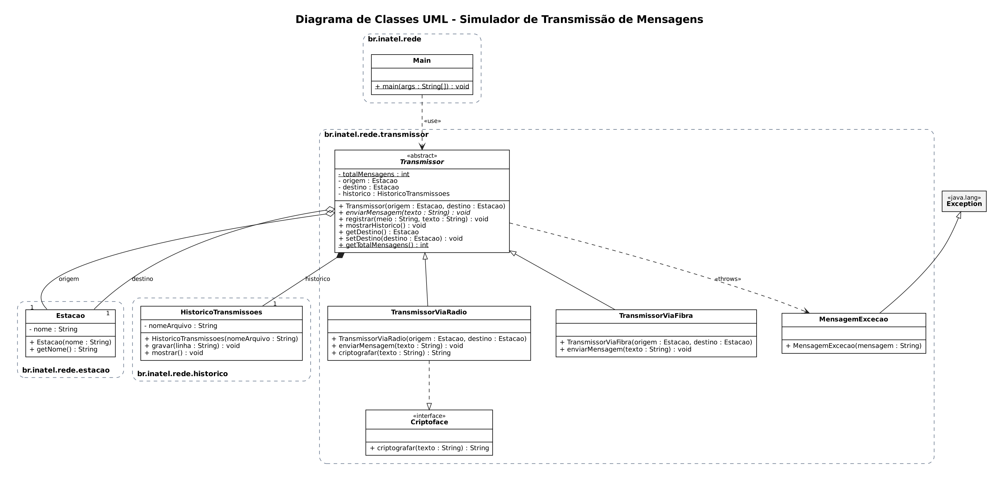

# Simulador de Transmissão de Mensagens em Rede

Projeto **C06 – B** (Inatel). A aplicação simula o envio de mensagens entre estações de uma rede de telecomunicações utilizando diferentes meios físicos de transmissão (**Fibra Óptica** e **Rádio**), aplicando conceitos de herança, polimorfismo, classes abstratas, interfaces, tratamento de exceções personalizadas e persistência de histórico em arquivo `.txt`.
(OBS: Exceto 'Threads', uma vez que foi desconsiderado na ativadade!

## Integrantes do Grupo

| Nome | Curso | Matrícula |
| :--- | :--- | :---: |
| Pedro José Alvarenga Pereira | Engenharia de Telecomunicações (GET) | 9851 |
| Gabriel Bolina Andrade | Engenharia de Computação (GEC) | 2164 |
| Ruan Carlo Martins Garcia | Engenharia de Software (GES) | 497 |
| Tales Costa Pignata Nobre Vilela | Engenharia de Computação (GEC) | 2102 |

## Estrutura do Projeto

* **`src/br/inatel/rede/Main.java`**: Classe principal responsável por instanciar as estações e os transmissores, realizar os envios polimórficos e tratar exceções.
* **`src/br/inatel/rede/estacao/Estacao.java`**: Representa os nós (estações de origem e destino) da rede.
* **`src/br/inatel/rede/historico/HistoricoTransmissoes.java`**: Gerencia a gravação e a leitura das mensagens transmitidas no arquivo `historico_transmissoes.txt`.
* **`src/br/inatel/rede/transmissor/`**: Contém a classe abstrata `Transmissor`, as subclasses `TransmissorViaFibra` e `TransmissorViaRadio`, a interface `Criptoface` e a exceção `MensagemExcecao`.
* **`diagrama-uml.png`**: Diagrama de classes UML completo da solução.

## Declaração de Uso de Inteligência Artificial

* **Ferramenta utilizada:** Google Gemini (modelo Hydrogen).
* **Como foi utilizada:** A ferramenta foi utilizada para auxiliar na concepção inicial de ideias voltadas à área de redes/telecomunicações, na revisão e depuração do código escrito em Java e na geração da sintaxe do diagrama UML.
* **Registro da conversa:** [Acessar histórico do chat](https://share.gemini.google/L5zDUgtJ2IXi))

## Diagrama UML
O diagrama abaixo representa a estrutura de classes,
seus relacionamentos, atributos e métodos.

